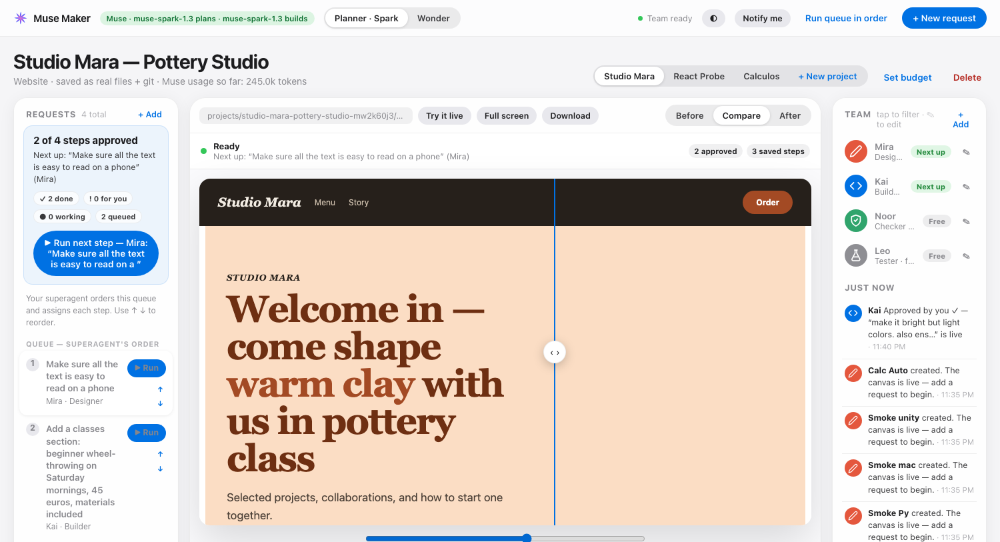

<h1 align="center">Muse Maker</h1>

<div align="center">
    
</div>

<p align="center">
    <b>See what your agents built — don't read about it.</b>
</p>

<p align="center">
    A visual, layman-friendly frontend for Muse.<br>
    No walls of text. No red/green diffs. The actual rendered change, who made it, and your approval before anything ships.
</p>

<hr>

## Overview

<p align="center">
  
</p>

Frontier coding agents are so productive that users eventually stop reviewing. They get flooded with text, shrug, and hit Accept — without actually knowing what changed. That's how bugs, ugly designs, and unwanted changes ship.

**Muse Maker fixes the review problem by making everything visual.** Your project renders live in the center. A superagent orders your requests and assigns them to a team of Muse subagents. Every step shows up as a draggable Before/After of the *real rendered project*, in plain English, with a live progress view — and nothing is final until you approve it.

<hr>

## Features

- **Visual, not textual**: Every change is a rendered Before/After you can drag, try live, and view full screen. Not a diff.
- **Any project**: Websites, phone-style apps, posters, dashboards, slides, shops, and real Vite + React apps — rendered from the actual files on disk.
- **Beyond the browser**: Python tools run and show their generated report live. Native Mac (SwiftUI) and Unity projects build for real on your Mac and show the latest build screen, build status, and logs.
- **A team, not a black box**: Designer, Builder, Checker, and Tester agents (editable, addable, with Muse-style icons) are planned and assigned automatically by a superagent. A separate Checker reviews every change before you see it.
- **Live progress you can actually spot**: Queue summary, per-step percentages and timers, per-teammate state pills, and brief one-line team messages in *Just now* — all updating live, no refresh needed.
- **You stay the boss**: Nothing ships without your approval. Every step is a git commit; view any point in history, restore it safely on top, or undo — history is never rewritten.
- **Muse only, cost-aware**: Every agent is a headless Muse session (`muse exec`, Meta provider). Spark-first configuration, per-project token budgets, and visible token costs keep charges in check.
- **Local-first**: Real projects live in `projects/` on your machine, each with its own git history. Import an existing folder and keep working on it.

## How It Works

1. **Describe it** — start a project from scratch or import an existing folder. Muse Maker can even decide the project type for you.
2. **Ask in plain English** — *"make it bright but light colors"* is a perfectly good request.
3. **The superagent plans** — it orders the queue and assigns each step to the right teammate.
4. **Agents build** — watch live phases, percentages, and timers while they edit the real files.
5. **You look, then decide** — compare Before/After, try it live, read the one-line summary, then Approve, Tweak, or Undo.

## Run It Locally

```bash
node server.mjs
# open http://localhost:5174
```

No dependencies, no build step. Authentication is your Muse login on this machine (`muse login`) — Muse Maker stores no API keys and talks to no third-party AI. It never uses OpenAI.

### Cost-saver mode

The default `.env` runs `muse-spark-1.3` for planning *and* building, at low reasoning effort with lean step caps. Flip **Planner · Spark/Wonder** in the header when you want deeper planning. Every card shows which Muse ran and how many tokens it used — cost is never hidden.

```bash
npm test   # regression-check the non-AI paths (spends no Muse tokens)
```

## Project Types

| Type | What you get |
|---|---|
| Website / Mobile app / Poster / Dashboard / Slides / Shop | Browser-rendered from real files, with templates to start from |
| React (Vite) | Real framework project: install, build, per-step build snapshots |
| Python tool | Runs `main.py`; its generated report renders live and clickable |
| Mac app (SwiftUI) | `swift build`, packaged and opened on your Mac with **Build + Run** |
| Unity game | Headless Unity build; latest build screen, status, and logs |

## Contributing

Contributions are welcome — bug fixes, features, and documentation alike. The bar is simple: if a non-technical user can't *see* what changed and confidently approve it, it's not done yet.

## Addendum

- Muse Maker is local-first by design: no cloud sync, no accounts, no collaboration yet. That's the honest next frontier.
- Live click-mirroring into native Mac/Unity apps isn't there yet — native projects show their latest build screen instead. Web projects are fully clickable via **Try it live**.
- If the Muse CLI is unavailable, a deterministic local fallback still makes real edits and commits — and the UI labels those steps as local, never as Muse work.
